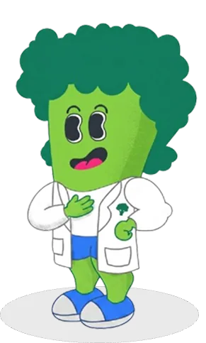
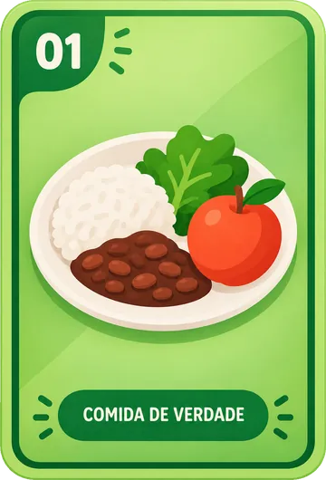
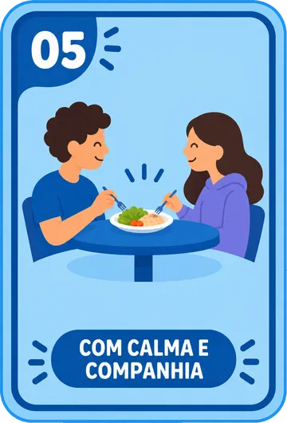
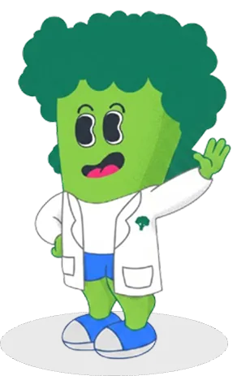

<div align="center">



# NutriTeens · Landing page

**Comer bem pode ser a sua próxima missão.**
O site que apresenta o NutriTeens, ensina a instalar a versão de testes e deixa qualquer pessoa experimentar uma missão ali mesmo.

<br>


<br>





</div>

---

## 🌱 Sobre o projeto

O **NutriTeens** é um aplicativo educativo que ajuda adolescentes de **10 a 15 anos** a construir hábitos alimentares mais saudáveis, a partir do [Guia Alimentar para a População Brasileira](https://bvsms.saude.gov.br/bvs/publicacoes/guia_alimentar_populacao_brasileira_2ed.pdf).

Em vez de contar calorias ou criar rankings, o app aposta em **missões, trilhas de aprendizagem e cartas colecionáveis**, com o mascote **Broxis** como companheiro de jornada. Ele nasceu de sessões de Design Participativo com adolescentes, professores e nutricionista, em escolas pública e privada de Viçosa-MG.

Este repositório é o **site do projeto**: a página que conta a história do app, mostra o que ele faz e leva a pessoa até a instalação.

> [!NOTE]
> O NutriTeens é educativo. Não faz diagnóstico, não prescreve dieta e não substitui o acompanhamento de profissionais de saúde.

## ✨ O que tem no site

| Página | Arquivo | O que faz |
| --- | --- | --- |
| **Início** | `index.html` | Apresenta o app, os recursos, o porquê do projeto, as dúvidas frequentes e a equipe |
| **Instalar no iPhone** | `ios.html` | Passo a passo com o TestFlight, em 5 passos |
| **Instalar no Android** | `android.html` | Dois caminhos: Google Play (teste fechado) ou arquivo APK pelo GitHub |

**Destaques**

- 🎮 **Mini-jogo "Experimente uma missão".** Três perguntas de verdadeiro ou falso, o Broxis reage a cada resposta e cada uma abre uma carta do Álbum do Guia.
- 📱 **Passo a passo por plataforma**, com dúvidas frequentes e avisos honestos sobre o que pode dar errado.
- 🌊 **Seções com bordas curvas** e blocos levemente inclinados, que dão o jeito brincalhão da marca.
- ♿ **Acessibilidade levada a sério**, com botão para pausar animações, foco visível e contraste conferido.
- 🪶 **Zero dependências.** HTML, CSS e JavaScript puros, sem build, sem framework, sem `node_modules`.

## 🗂️ Estrutura

```text
.
├── index.html          # página inicial (inclui o mini-jogo)
├── ios.html            # instalar no iPhone (TestFlight)
├── android.html        # instalar no Android (Google Play ou APK)
├── css/
│   └── style.css       # todo o visual do site
├── js/
│   └── a11y.js         # botão "Pausar animações"
└── assets/             # logo, favicon, Broxis, cartas e fontes Sora
```

## 🚀 Rodando localmente

Não há nada para instalar. Escolha um jeito:

```bash
# 1) abrir direto no navegador
open index.html            # macOS  (Linux: xdg-open · Windows: start)

# 2) ou subir um servidor local (recomendado)
python3 -m http.server 8000
# depois acesse http://localhost:8000
```

## 🔗 Antes de publicar: troque os 3 links de instalação

As páginas de instalação vêm com links de exemplo. Procure por `SEU` nos arquivos e troque pelos links reais:

```bash
grep -rn "SEU" *.html
```

| Arquivo | Link de exemplo | Troque por |
| --- | --- | --- |
| `ios.html` | `https://testflight.apple.com/join/SEU-CODIGO` | Link público do grupo de testes no TestFlight |
| `android.html` | `https://play.google.com/apps/testing/SEU.PACOTE` | Link de entrada do teste fechado na Google Play |
| `android.html` | `https://github.com/SEU-USUARIO/SEU-REPOSITORIO/releases/latest` | Página de releases onde fica o arquivo `.apk` |

> [!IMPORTANT]
> Se esses links não forem trocados, os botões "Abrir o convite" e "Abrir a página de downloads" levam a páginas que não existem.

## ▲ Deploy na Vercel

1. Em [vercel.com/new](https://vercel.com/new), importe este repositório.
2. Em **Framework Preset**, escolha **Other**.
3. Deixe **Build Command** e **Output Directory** em branco. O site já está pronto.
4. Clique em **Deploy**.

A partir daí, cada `git push` na branch de produção (normalmente `main`) publica uma nova versão. Outras branches geram endereços de **Preview**, que não alteram o site principal.

> [!TIP]
> Os arquivos precisam estar na **raiz** do repositório. Se estiverem dentro de uma subpasta, ajuste o **Root Directory** em *Settings → General*.

## ✏️ Como editar

- **Textos:** estão direto nos arquivos `.html`. É só abrir e editar.
- **Cores e visual:** ficam no começo do `css/style.css`, nas variáveis de `:root`.
- **Perguntas do mini-jogo:** no final do `index.html`, procure por `const Q = [`. Cada pergunta tem o enunciado (`t`), a resposta certa (`a`), a explicação (`why`) e a carta que ela abre (`img` e `alt`).

### 🎨 Paleta e tipografia

| Cor | Hex | Uso |
| --- | --- | --- |
| Lima | `#8BCF4A` | Destaques, botões de ação, letreiro |
| Verde-floresta | `#155946` | Faixas escuras com bordas curvas |
| Verde profundo | `#1B4332` | Texto, botões escuros |
| Menta | `#CDE7D6` | Cartões e fundos suaves |
| Creme | `#F1F8E8` | Fundo da página |
| Oliva | `#3F6B0F` | Textos pequenos em verde (contraste de 5,8:1 sobre o creme) |

A fonte é a **Sora** (Regular, SemiBold e ExtraBold), carregada localmente a partir de `assets/`.

## ♿ Acessibilidade

O site foi pensado para ser usado por todo mundo, inclusive por quem usa teclado ou leitor de tela.

- Link "Ir para o conteúdo" e estrutura de títulos sem saltos
- Foco do teclado visível, inclusive sobre as faixas escuras
- Contraste de texto conferido (mínimo de 4,5:1 nos textos pequenos)
- Botão **Pausar animações**, que lembra a escolha da pessoa, e respeito automático a `prefers-reduced-motion`
- Passos numerados que o leitor de tela anuncia ("Passo 1")
- Links externos avisam "abre em nova aba"
- Mini-jogo operável só com teclado, com resultados anunciados em voz
- Conteúdo continua visível mesmo com o JavaScript desligado

## 📲 Para quem mantém o app: o que muda a cada plataforma

Um resumo do que vale lembrar ao distribuir as versões de teste.

- **iPhone (TestFlight):** exige conta no Apple Developer Program. Cada versão de teste expira em **90 dias**, e o primeiro build para testadores externos passa por uma revisão da Apple (Beta App Review).
- **Android (Google Play):** contas pessoais criadas depois de 13/11/2023 precisam de um teste fechado com **pelo menos 12 testadores por 14 dias seguidos** antes de publicar na loja.
- **Android (APK):** desde setembro de 2026, no Brasil, o Android exige que o app esteja registrado por um **desenvolvedor verificado** para instalar sem etapas extras. Registre o pacote no Android Developer Console, ou o APK pode ser bloqueado em alguns celulares.

## 👥 Quem faz o NutriTeens

O NutriTeens é desenvolvido na **Universidade Federal de Viçosa (UFV)**, em parceria entre o **Departamento de Nutrição e Saúde** e o **Departamento de Informática**, como projeto de Iniciação Científica (PIBIC/CNPq).

- **Ana Elisa Silva Pinto**, colaboração em Nutrição
- **Isabela Cristina da Silva Nascimento**, colaboração em Nutrição
- **Maria Lúcia Bento Villela**, orientadora
- **Gustavo Santos Pinto**, bolsista de Iniciação Científica, desenvolvimento e pesquisa

Pesquisa aprovada pelo Comitê de Ética em Pesquisa da UFV (CAAE 94172425.4.0000.5153). Agradecemos às escolas, professores, nutricionista e adolescentes que participaram das sessões de Design Participativo.

## 🔗 Links

- 🎨 [Protótipo no Figma](https://www.figma.com/design/Ckl9eni0Mxqnb0QPM0pmhx/IIRE_2026?node-id=0-1&t=lJZu1jk4vyoPmUJK-1)
- 📖 [Guia Alimentar para a População Brasileira](https://bvsms.saude.gov.br/bvs/publicacoes/guia_alimentar_populacao_brasileira_2ed.pdf)

## 📄 Licença

Distribuído sob a licença **MIT**.

<div align="center">

<br>



**Pequenas ações todo dia. Hábitos que ficam.**

</div>
